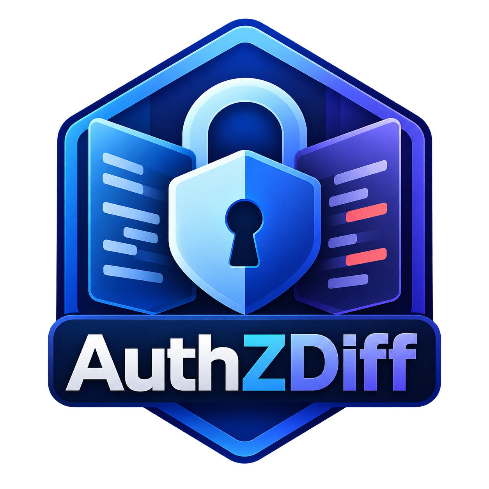
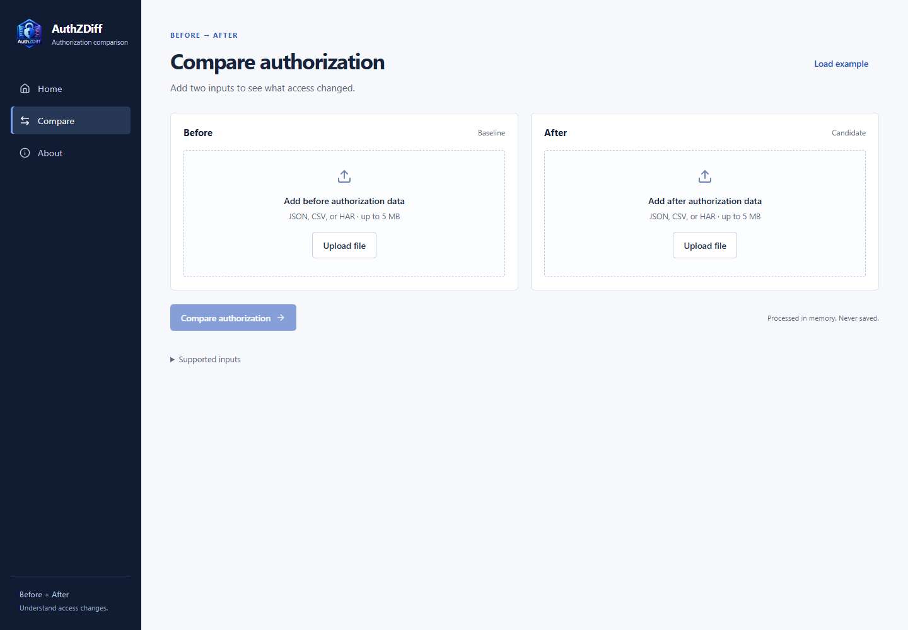
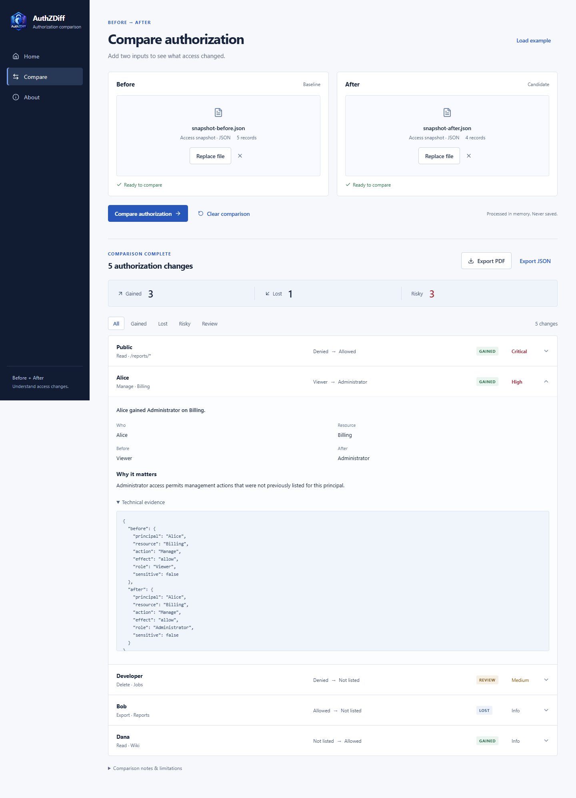
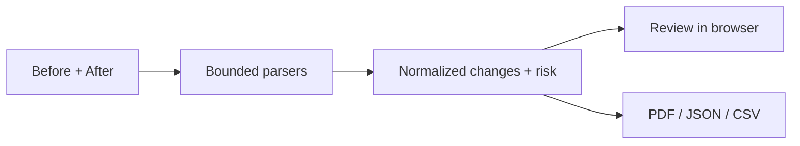

<p align="center"></p>

# AuthZDiff

**Compare authorization states and identify meaningful access changes.**

[](https://github.com/mosaddiqurr/ADPathLens/actions/workflows/ci.yml)
[](https://github.com/mosaddiqurr/ADPathLens/releases/tag/v1.0.0)
[](LICENSE)

[Run locally](#run-locally) · [Example inputs](examples/) · [Documentation](#documentation) · [Changelog](CHANGELOG.md)

## Overview

AuthZDiff compares a **Before** baseline with an **After** candidate and highlights access gained,
access lost, and risky changes. Upload JSON or CSV access snapshots, or compare two HAR captures,
review the evidence, and export PDF, JSON, or CSV reports. The application opens directly and
processes one comparison in memory, without account or database setup.

This repository, [mosaddiqurr/ADPathLens](https://github.com/mosaddiqurr/ADPathLens), contains
the AuthZDiff application. See [v1.0.0 release notes](CHANGELOG.md#100---2026-10-13).

## Core workflow

1. Open **Compare**.
2. Upload **Before** and **After** authorization data, or load the fictional example.
3. Select **Compare authorization**.
4. Review **Gained**, **Lost**, and **Risky**, expanding a change for its explanation.
5. Export a **PDF** report or **JSON** evidence. CSV is available under comparison notes.

Navigation is **Home · Compare · About**. Reports are generated from Compare.

## Features

- A single two-input workflow with filename, recognized format, record count, and validation state.
- Explicit access gains/losses, recognized role escalation, public expansion, and removed denies.
- Explainable risk priorities, with ordinary grants kept informational.
- Before/After details and redacted technical evidence behind disclosure controls.
- No-change results, safe errors, responsive layout, keyboard navigation, and bounded imports.
- Reports recomputed from the current inputs, independent of the visible result filter.

## Supported inputs

| Input | What it describes |
| --- | --- |
| JSON snapshot | An array of explicit principal/resource/action records, or a versioned records wrapper |
| CSV snapshot | The same explicit access records as columns |
| HAR capture | HTTP requests/responses, with optional identity and authorization annotations |

JSON and CSV snapshots can be compared together. Compare HAR to HAR. AWS IAM policies,
arbitrary role graphs, raw HTTP, and cURL commands are not supported user inputs; AuthZDiff
does not claim to evaluate their effective permissions.

Each input is limited to **5 MiB**, **2,000 snapshot records** or **500 HAR entries**.
HAR response/request bodies are bounded to 256 KiB; displayed excerpts to 8,000 bytes.
Duplicate snapshot tuples and repeated identical HAR requests are rejected as ambiguous.

See [input contracts and examples](docs/INPUTS.md). Everything in [examples/](examples/) is fictional.

## Screenshots

### Home


### Compare


### Results


### Explanation and evidence


These screenshots show the current simplified product and synthetic inputs.

## How comparison works

Snapshots match exact principal/resource/action tuples. Adding an allow, replacing a deny with
an allow, or moving up the documented role ordering produces a gain; removing an allow,
adding a denial to a prior allow, or moving down produces a loss. Other changes need review.
Public aliases (`*`, Public, Anonymous, Unauthenticated) normalize to Public.

**Not listed means absent from the supplied snapshot.** It does not prove that live access is
blocked. Inheritance, conditional policies, wildcard coverage, and cross-rule deny precedence
are not evaluated.

HAR matching uses the annotated principal, origin/path, method, non-credential query values,
and exact path, request-body/form, and non-credential header context. Status, safe headers,
redirects, redacted JSON structure/values,
and normalized text are compared using the preserved response engine.
A 403 -> 200 or 200 -> 403 is an observed gain/loss only when matching identity, explicit
access annotations, corroborating responses, and complete evidence support it.
Status-only changes and requests missing from one capture remain informational review items.

See [comparison logic](docs/COMPARISON-LOGIC.md).

## Risk model

| Priority | Defensible trigger |
| --- | --- |
| Critical | New public access with sensitive, administrative, or wildcard scope |
| High | Public access, recognized new administrator access, wildcard grant, or deny replaced by allow |
| Medium | Sensitive resource gain, recognized non-admin role escalation, or a removed deny without a proven grant |
| Low / Info | Low is reserved for future supported rules; ordinary changes are informational |

A newly introduced admin label is high priority even when the preceding custom role's hierarchy
is unknown; its access direction remains a review item. Sensitive resources are explicitly
marked in the input. Risky counts **overlap** gained/lost counts; they are not additive totals.
These are review priorities, not vulnerability scores or proof of exploitability.
For corroborated HAR observations, an ordinary denied-to-allowed transition is medium priority;
public or explicitly sensitive gains are high, and sensitive public gains are critical.
Uncorroborated or unmatched capture changes remain informational review items.

## Architecture

**React/TypeScript + a stateless Python/FastAPI backend.** Browser-side state holds one current
comparison. The Python backend preserves the strong parsing, redaction, and response-difference
logic, processes bounded requests in memory, and generates reports in memory.



There is no SQLite/PostgreSQL, ORM, migration, job worker, account system, saved comparison,
or external request replay. The backend never contacts URLs in HAR files.
No analytics or external service receives uploaded content.
Running locally keeps processing on your computer; a remotely hosted instance processes
inputs on that instance's server.

See [architecture](docs/ARCHITECTURE.md) and [security controls](docs/SECURITY.md).

## Run locally

Requirements: **Python 3.12+**, **Node.js 22.13+ (22.x) or 24+**, and npm.

### Windows / PowerShell

```powershell
git clone https://github.com/mosaddiqurr/ADPathLens.git
Set-Location ADPathLens
python -m venv .venv
.\.venv\Scripts\python -m pip install -r backend\requirements-dev.lock
Push-Location frontend
npm ci
Pop-Location
powershell -NoProfile -ExecutionPolicy Bypass -File scripts\runtime.ps1 start
```

Open **http://localhost:4174**. No password, seed, keys, or migration is needed.

```powershell
powershell -NoProfile -ExecutionPolicy Bypass -File scripts\runtime.ps1 health
powershell -NoProfile -ExecutionPolicy Bypass -File scripts\runtime.ps1 status
powershell -NoProfile -ExecutionPolicy Bypass -File scripts\runtime.ps1 stop
```

### Linux / macOS

```bash
git clone https://github.com/mosaddiqurr/ADPathLens.git
cd ADPathLens
python3 -m venv .venv
.venv/bin/python -m pip install -r backend/requirements-dev.lock
(cd frontend && npm ci)
```

In one terminal:
```bash
cd backend
../.venv/bin/python -m uvicorn app.main:app --host 127.0.0.1 --port 8020 --no-access-log
```

In another:
```bash
cd frontend
npm run dev
```

A small Linux launcher is also available: `bash scripts/runtime.sh start|status|health|stop`.
See [local running and deployment configuration](docs/LOCAL-RUN.md).

## Deployment

For same-origin hosting, the supplied containers serve the frontend and proxy `/api/` to the
internal backend. For separate hosting, set `VITE_API_URL` to the backend origin before building
the frontend, and configure exact backend `ALLOWED_HOSTS` and `ALLOWED_FRONTEND_ORIGINS`.
The static host must rewrite `/compare` and `/about` to `index.html`. Use HTTPS and upstream
access/capacity controls. See [deployment instructions](docs/DEPLOYMENT.md) for startup commands,
health checks, request limits, CORS, CSP, and privacy configuration.

## Testing and production build

```powershell
Push-Location backend
..\.venv\Scripts\python -m ruff format --check --no-cache app tests
..\.venv\Scripts\python -m ruff check --no-cache app tests
..\.venv\Scripts\python -m mypy --no-incremental app
..\.venv\Scripts\python -m pytest -p no:cacheprovider
..\.venv\Scripts\python -m bandit -q -r app
..\.venv\Scripts\python -m pip_audit -r requirements-dev.lock
Pop-Location
Push-Location frontend
npm run lint
npm test
npm run build
npm audit
npm run e2e
Pop-Location
.\.venv\Scripts\python scripts\verify-publication.py
```

Playwright tests desktop and mobile upload/compare/export workflows and axe accessibility.
It starts the backend and built frontend preview when they are not already running.
On Windows it uses installed Microsoft Edge; in CI it uses Chromium.
On Linux, install the browser with `npx playwright install --with-deps chromium`;
set `CI=1` for Chromium selection. Build first when testing the production preview.

See [testing scope](docs/TESTING.md). [GitHub Actions](https://github.com/mosaddiqurr/ADPathLens/actions)
runs backend, frontend, and browser checks for pushes to `main` and for pull requests.

## Reporting

**PDF** is concise and prioritizes the first 100 changes. It includes summary, risky changes,
ordinary gains/losses, recommendations, source-state evidence, and limitations.
**JSON** includes every change and redacted technical evidence. **CSV** exports every change
with formula injection protection.

Exporting recomputes the comparison from the same inputs, so client-edited report payloads
cannot fabricate results. Inputs and report bytes are never saved by the backend.
Only a user-initiated download writes an export. Review reports before sharing; redaction is best effort.

See [reporting](docs/REPORTING.md).

## Limitations

- Snapshots contain explicit listed access, not a complete effective-policy model.
- Only Viewer/Reader/Read-only, Developer/Editor, and Admin/Administrator/Owner have a recognized order.
- HAR status changes, changed request context, missing capture coverage, and incomplete evidence need review.
- PDF uses ReportLab's bundled Vera font; complex scripts and right-to-left shaping are not guaranteed.
  JSON preserves Unicode evidence.
- Inputs are bounded; larger/ambiguous exports need preprocessing.
- The default application is local and has no authentication. An exposed instance requires
  operator-controlled HTTPS, network access, and resource limits.
- Docker configuration is supplied; local release checks do not claim a validated container runtime.
- Publication scanning checks current publishable files and reachable historical Git paths/blobs
  for recognizable credentials and private artifacts. Detection is best effort.

See [known limitations](docs/KNOWN-LIMITATIONS.md).

## Documentation

| Guide | Contents |
| --- | --- |
| [Local run](docs/LOCAL-RUN.md) | Prerequisites, launchers, ports, and configuration |
| [Inputs and examples](docs/INPUTS.md) | JSON, CSV, and HAR contracts |
| [Comparison logic](docs/COMPARISON-LOGIC.md) | Matching, access direction, and risk rules |
| [Architecture](docs/ARCHITECTURE.md) | Frontend, API, and in-memory processing |
| [Reporting](docs/REPORTING.md) | PDF, JSON, and CSV exports |
| [Deployment](docs/DEPLOYMENT.md) | Containers, separate hosting, and operator controls |
| [Security](docs/SECURITY.md) | Redaction, request limits, and privacy controls |
| [Testing](docs/TESTING.md) | Automated checks and browser verification |
| [Known limitations](docs/KNOWN-LIMITATIONS.md) | Supported scope and interpretation limits |
| [Contributing](CONTRIBUTING.md) | Development setup, validation, and pull requests |

## License and author

[MIT](LICENSE).

Designed and built by **[Mosaddiqur Rahman ↗](https://www.linkedin.com/in/mosaddiqur/)**.
