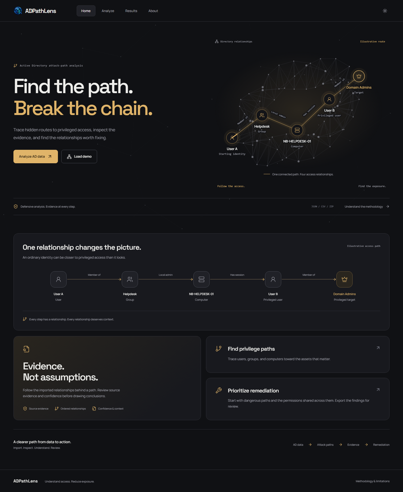
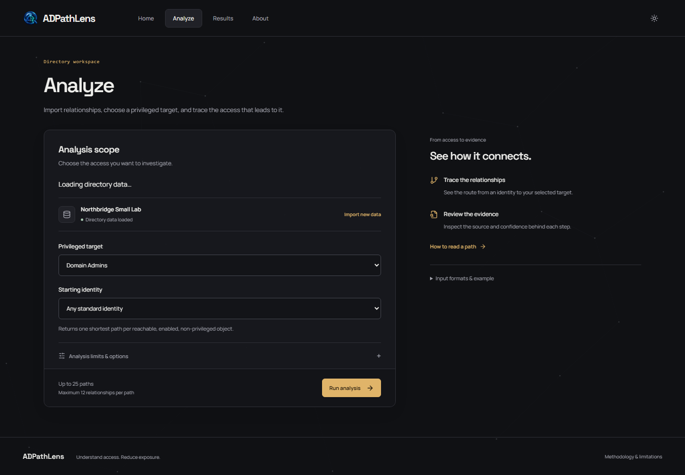
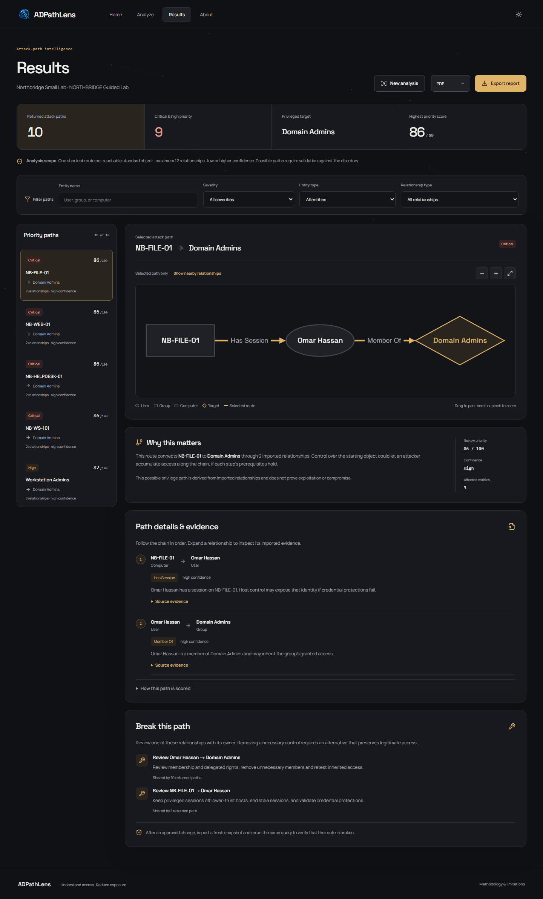
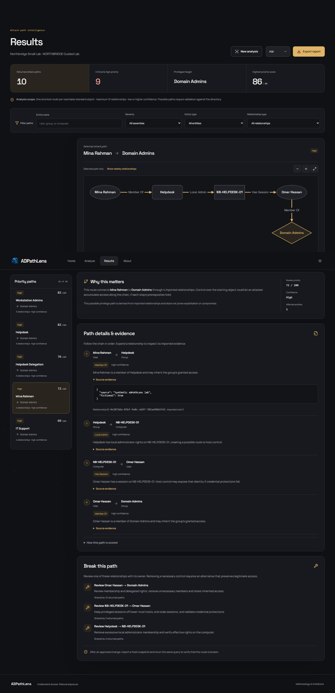

<p align="center"></p>

# ADPathLens

Find risky Active Directory attack paths and understand how to break them.

<p><a href="LIVE_DEMO_URL"></a></p>

## Overview

ADPathLens is a focused defensive analysis tool for answering a practical question: **how could an attacker reach a privileged asset, what evidence supports that route, and which access should be reviewed?** It turns authorized directory snapshots into bounded, explainable paths. It is designed to be small enough to demonstrate and explain in an interview.

## Core workflow

**Import AD data → Analyze → Inspect risky paths → Review evidence → Review remediation → Export**

The application has four destinations: **Home**, **Analyze**, **Results**, and **About**. Results brings prioritization, the selected graph, step evidence, remediation, and export into one workspace.

## Screenshots






These images are captured from the running application using fictional NORTHBRIDGE data.

## Key capabilities

- ADPathLens JSON, paired CSV, and constrained ZIP import, with validation before persistence.
- Snapshot-scoped NetworkX multigraph analysis: shortest hops, lowest cost, multiple routes, and reverse reachability.
- Critical/high prioritization, entity-name search, entity-type filters, and relationship-type filters.
- An ordered Cytoscape path graph with pan, zoom, fit, selected nodes, labels, and optional nearby context.
- Per-step entity types, relationship explanations, source evidence, and confidence.
- Remediation recommendations ranked by how many returned paths share a relationship.
- A concise PDF report and complete JSON export of the selected analysis and supporting evidence.
- A downloadable fictional dataset and a short demo journey.
- Dark/light themes, animated topology, purposeful transitions, and an optional reduced-animation preference under About.

## Run locally

Requirements: Python 3.12+, Node.js 22+, and npm. From the repository root on Windows:

```powershell
python -m venv backend/.venv
backend/.venv/Scripts/python.exe -m pip install -e "./backend[dev]"
npm --prefix frontend ci
if (-not (Test-Path -LiteralPath '.env')) { Copy-Item .env.example .env }
```

Start the backend in one terminal:

```powershell
cd backend
$env:LOCAL_MODE = 'true'
.venv/Scripts/python.exe -m alembic upgrade head
.venv/Scripts/python.exe -m uvicorn app.main:app --host 127.0.0.1 --port 8011 --no-proxy-headers
```

Start the frontend in another terminal:

```powershell
cd frontend
$env:VITE_API_PROXY_TARGET = 'http://127.0.0.1:8011'
npm run dev
```

Open **http://127.0.0.1:5173**. Vite proxies API requests to port 8011. If a chosen port is occupied, use a free port and update the proxy/origin settings as described in [RUN_LOCAL.md](RUN_LOCAL.md). Local portfolio mode opens a dedicated analyst session automatically. SQLite snapshots and analyses persist in `backend/adpathlens-local.db`; report files persist in `backend/reports`. Set `LOCAL_MODE=false` for account setup and password authentication; use a separate database when switching modes. On macOS/Linux use `backend/.venv/bin/python` and `cp .env.example .env`.

An optional migration-first controller starts both services and selects free loopback ports: `backend/.venv/Scripts/python.exe scripts/adpathlens.py start`. Its `status`, `health`, `stop`, and `restart` commands manage only its owned services. See [RUN_LOCAL.md](RUN_LOCAL.md).

## Demo in a few minutes

1. Open Home and choose **Load demo**.
2. On Analyze, keep **Domain Admins** as the privileged target and **Any standard identity** as the start.
3. Choose **Run analysis**.
4. Select a path, follow its graph, and expand **Source evidence** on a relationship.
5. Read **Why this matters** and **Break this path**, then export PDF or JSON.

NORTHBRIDGE is entirely fictional: 35 directory objects and at least 55 relationships. An example chain connects Mina Rahman through Helpdesk access and a privileged session to Domain Admins. The graph is illustrative; real exploitability depends on actual controls and prerequisites. Download `frontend/public/northbridge-demo.json` for an example of the accepted schema.

## Supported inputs

| Input | Required shape |
| --- | --- |
| JSON | One object with `metadata`, `nodes`, and `relationships` |
| CSV | `nodes.csv` and `relationships.csv`, using the documented columns |
| ZIP | Those two CSV files at the archive root; no nested directories |

Imports must pass server validation, retain a matching validation digest, acknowledge warnings, and confirm authorized use. Raw uploads are not retained. Collector-specific exports, including native BloodHound schemas, need conversion to the [ADPathLens format](docs/DATA_FORMAT.md).

## Attack-path example

The fictional Mina Rahman route follows group membership, delegated computer administration, a privileged session, and membership in Domain Admins. Each step refers to an imported relationship and its source evidence. Review the shared access or session relationship under **Break this path**, validate its prerequisites, and retest after an approved change. A route is a hypothesis supported by the supplied snapshot, not proof of exploitation.

## Graph and data model

A directed edge represents a modeled access or control relationship. Context-only edges such as `ConnectedTo` are excluded from privilege traversal. Paths retain the evidence supplied with each relationship.

The existing priority score is `100 − 3 × effective relationship cost − hop count`, clamped to 0–100. Confidence and inheritance can increase effective cost. Priority bands are **critical ≥85**, **high ≥65**, **medium ≥35**, and **low <35**. This is a review indicator, not an exploit probability or a calibrated business-impact score.

The default query returns one shortest route per reachable enabled, non-privileged object to the selected target. Selecting a starting object allows alternate routes or a shortest/lowest-cost query. The limits are 12 relationships and 25 returned paths, with a shared work/time budget. Partial results are labeled. An empty result applies only to the selected scope; it does not establish that the directory is secure. See [attack paths](docs/ATTACK-PATHS.md).

## Architecture

The application runs directly as a static frontend and a Python backend:

```text
React + TypeScript + Vite
        │ same-origin /api proxy
FastAPI + Pydantic validation
        │
SQLAlchemy + SQLite (persistent file)
        │ snapshot-scoped graph
NetworkX bounded path traversal
        │
Cytoscape visualization + ReportLab PDF / JSON
```

No workers or external graph database are needed. Graph rendering is loaded when Results needs it. The database schema and compatibility APIs for findings, remediation simulations, comparisons, and administration remain for existing data and regression coverage. Their separate screens and lifecycle workflows are outside the focused product routes. [Architecture details](docs/ARCHITECTURE.md).

## Reports

Results exports the selected completed analysis to PDF or JSON, preserving its snapshot, query scope, score, relationship evidence, and remediation. PDF summarizes five priority paths/findings; JSON retains all returned records. Downloads require an authorized session. Display filters do not change the exported analysis. [Report format](docs/REPORTING.md).

## Authentication and persistence

Shared mode uses password login, opaque HttpOnly sessions, CSRF tokens, role checks, and object ownership. Sessions, projects, demo/imported snapshots, analyses, and report metadata are stored in SQLite. A backend restart retains these records and unexpired sessions. Report files must persist alongside the database. SQLite uses WAL and a 30-second busy timeout; deploy one backend instance on a persistent local disk. Back up with SQLite's backup API, and preserve report files; do not copy a live database file without its WAL.

## Direct deployment

For Netlify, set the base directory to `frontend`, build command to `npm run build`, and publish directory to `dist`. Set **`VITE_API_URL=https://api.your-domain.example` before building**. The bundled `_redirects` provides the SPA fallback. Equivalent static hosts must serve `index.html` for application routes. Frontend environment variables are public; put secrets only in the backend.

For Render or an equivalent Python host, use root directory `backend`, build command `pip install .`, and start command **`python scripts/start.py`**. Attach a persistent disk at `/data`, then configure the variables in [backend/.env.production.example](backend/.env.production.example). The startup command creates storage directories, applies migrations, and starts one Uvicorn process on the host's `PORT`. Terminate HTTPS at the hosting ingress; expose only the ingress to public traffic.

Use `https://app.your-domain.example` and `https://api.your-domain.example` under the same registrable domain with `SESSION_COOKIE_SECURE=true` and `SESSION_COOKIE_SAMESITE=lax`. Set `ALLOWED_FRONTEND_ORIGINS` to the exact frontend origin, plus HTTPS public URLs and a random backend secret. Disable `LOCAL_MODE`, `DEMO_MODE`, and `E2E_MODE`; authenticated **Load demo** remains available. Different provider domains require `SESSION_COOKIE_SAMESITE=none` and secure cookies, but browsers may block third-party cookies; same-site custom domains are the reliable deployment choice. Complete the first administrator setup privately before opening access. See [deployment details](docs/DEPLOYMENT.md).

## Security and input handling

Use synthetic data or data collected from systems you own or are explicitly authorized to assess. ADPathLens does not collect from LDAP, execute directory changes, or establish compromise.

Local mode is explicitly limited to development and loopback. It creates an analyst, not an administrator, and retains opaque HttpOnly sessions, CSRF tokens, role checks, workspace membership, and server-side object ownership. Local session creation checks the peer, host, origin, and a custom request header. It refuses to bootstrap over an existing account database. Keep both local services bound to loopback; disable local mode for shared hosting.

Existing controls include bounded uploads, archive traversal/bomb defenses, depth and graph limits, source validation, escaped report text, safe CSV cells, and authorization on report downloads. Production startup requires secure cookies, explicit HTTPS origins, absolute persistent SQLite/report paths, a suitable secret, and disabled local/demo/test modes. [Security model](docs/SECURITY.md).

## Limitations

- Accuracy depends on the completeness, direction, freshness, and confidence of imported relationships.
- A possible path does not prove that any step is exploitable or that compromise occurred.
- Session, GPO, delegation, and certificate-service models simplify real prerequisites. Context-only certificate enrollment edges do not establish an exploit chain.
- Results are bounded and are not an exhaustive inventory of all paths or all vulnerable AD configurations.
- Recommendations require owner review. Retest with fresh data after an approved change; an alternative route may remain.
- PDF summarizes five priority paths/findings and abbreviates long evidence. JSON retains all returned records.
- SQLite deployment supports one backend instance; hosting TLS, disk permissions, backups, and retention remain operator responsibilities.

## Testing

```powershell
# Frontend (from frontend/)
npm run test:coverage
npm run lint
npm run format:check
npm run typecheck
npm run build
npm audit --audit-level=low
npx playwright install chromium
npm run test:e2e

# Backend (from backend/)
.venv/Scripts/python.exe -m pytest --cov=app --cov-fail-under=65
.venv/Scripts/python.exe -m ruff check app tests scripts ../scripts/adpathlens.py
.venv/Scripts/python.exe -m ruff format --check app tests scripts ../scripts/adpathlens.py
.venv/Scripts/python.exe -m mypy app --no-incremental
.venv/Scripts/python.exe -m bandit -r app -q
.venv/Scripts/python.exe -m pip_audit
```

Playwright launches an isolated backend, imports the demo, exercises evidence, graph controls, remediation, PDF/JSON downloads, persistence, validation failures, and navigation. It checks every major screen at 1440, 1366, 768, and 390px, including centered containers, overflow, and serious/critical accessibility issues. A production-mode HTTPS acceptance command (`backend/.venv/Scripts/python.exe backend/scripts/direct_acceptance.py`) checks separate frontend/backend origins, secure cookies, login/logout, concurrent writes, persisted imports/analyses/exports, and backend-only restart. It requires OpenSSL, installed frontend dependencies, and Chromium. Its certificate and application state are disposable. The backend suite retains import, security, isolation, report, simulation, comparison, and performance coverage. See [testing instructions](docs/TESTING.md).

## License

[MIT License](LICENSE).

## Author

[Mosaddiqur Rahman](https://github.com/mosaddiqurr).
