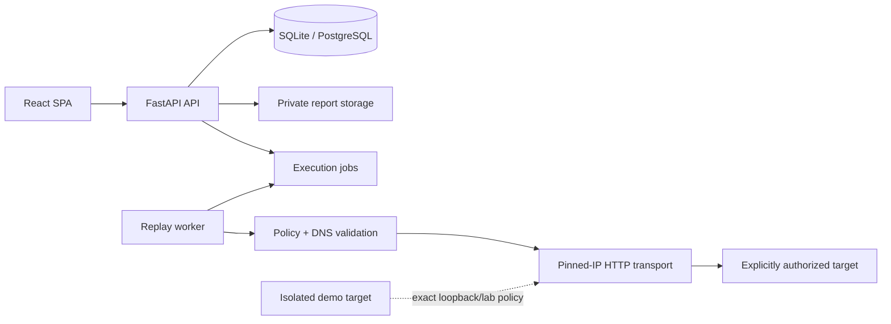

# Architecture

AuthZDiff is a single-workspace, single-node application with independently runnable API, replay
worker, SPA, database, report storage, and demo-target processes.

The browser never contacts a tested target. API mutations require an authenticated opaque session
and CSRF token. A run reserves concurrency leases and target-budget slots in the same database
transaction that creates its queued job. An external worker atomically claims one job, records its
identity and heartbeat, executes the higher profile then lower profile, and persists bounded
observations. Comparison and candidate-finding generation occur only after both observations
complete.

The backend can use in-process execution for tests and simple development, but the release runtime
and production configuration use `REPLAY_EXECUTION_MODE=external`. PostgreSQL supports meaningful
concurrency. SQLite uses the same schema and semantics but is limited by its single-writer behavior.

Reports are generated server-side into a private configured root. Database rows store canonical
content hashes, final-file hashes, safe names, state, and ownership. The frontend downloads only
through an ownership-checked API route.
