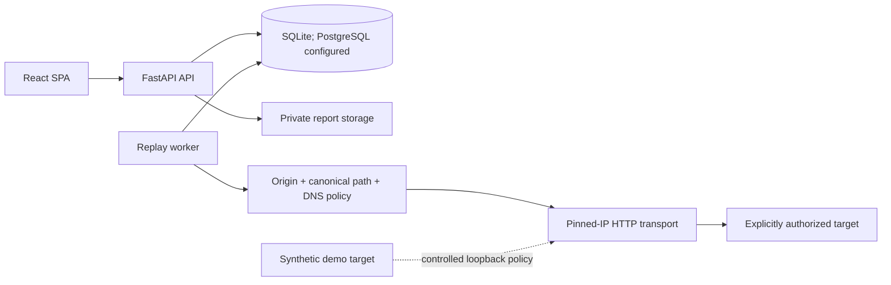

# Architecture

AuthZDiff is a single-workspace black-box HTTP authorization testing application with independently
runnable API, replay worker, SPA, database, report storage, and synthetic demo-target processes.

The browser never contacts a tested target. API mutations require an authenticated opaque session
and CSRF token. A run reserves database concurrency leases and two target-budget slots, then an
external worker atomically claims the job, records identity/heartbeat, executes the higher profile
before the lower profile, normalizes/redacts each response before persistence, and compares only
after both observations exist.

The local and clean-source acceptance runtime uses SQLite and an external worker. PostgreSQL support
exists in drivers, settings, migrations, and Compose configuration but remains runtime-unverified.
SQLite connections explicitly enable foreign-key enforcement and remain limited by single-writer
behavior.

Reports are generated server-side beneath a configured private root. Database rows store safe names,
ownership, state, canonical content hashes, and final-file hashes. Downloads always recheck project
ownership and the resolved storage path.
